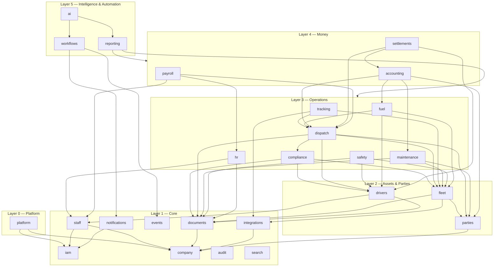

# NEWAY TMS — System Architecture

**Status:** Phase 1 (Architecture) — awaiting approval before Phase 2.
**Date:** 2026-09-06
**Related:** [ROADMAP.md](ROADMAP.md) · [DATABASE.md](docs/DATABASE.md) · [MULTI_TENANCY.md](docs/MULTI_TENANCY.md) · [RBAC.md](docs/RBAC.md) · [AI_ARCHITECTURE.md](docs/AI_ARCHITECTURE.md) · [INTEGRATIONS.md](docs/INTEGRATIONS.md)

---

## 1. What this is

NEWAY TMS is a multi-company transportation management platform: one deployment, many independent trucking companies, each with its own users, fleet, drivers, loads, money, safety, HR, maintenance, and settings, fully isolated from every other company.

It is built **from the business model outward**. The database and the business processes (load lifecycle, asset lifecycle, driver lifecycle, money flow) are the foundation. Dashboards are presentation. AI is an intelligence layer over trustworthy data. Integrations are external data sources behind adapters. Users, roles, and permissions are the security layer around all of it.

### 1.1 Independence statement

This project is new and standalone. It has its own repository (`git init` in this folder, no remote), its own dependency tree, its own schema, its own design system, and its own business logic. Nothing is imported, linked, copied, or referenced from any other project on this machine. Business rules that the company already applies (pay schemes, SLAs, penalties) will be captured as **requirements from the owner** at the phase where they are needed, not read out of prior code.

---

## 2. Architecture principles

| # | Principle | What it means in practice |
|---|---|---|
| P1 | Business model first | Entities and state machines are designed before any screen. Every screen is a view over the model, never the other way around |
| P2 | Tenant isolation is structural | `company_id` on every tenant row, enforced by the ORM layer **and** PostgreSQL row-level security. The client never supplies a tenant id |
| P3 | Modular monolith | One deployable, many bounded modules with explicit dependencies. Modules talk downward by calls and upward by events. Extraction into services later is possible because module boundaries are real |
| P4 | Explicit permissions | Every endpoint declares the permission it requires. Deny by default. Enforced on the backend; the UI only hides |
| P5 | Everything important is auditable | State-changing service methods write an audit row and a domain event in the same transaction |
| P6 | Adapters at the edges | Telematics, fuel cards, maps, messaging, storage, accounting, LLMs are behind provider interfaces with mock implementations. No provider name appears in business logic |
| P7 | Automation acts through the same doors as people | Workflows and AI execute service methods under a principal with permissions, and are audited like users |
| P8 | Honest system | Nothing is faked. A disconnected integration says so. A mock provider is labeled as a mock |
| P9 | No over-engineering | No microservices, no message broker, no second datastore until a measured need exists. PostgreSQL does the queue, the pub/sub, the search, and the cache in v1 |

---

## 3. Technology stack

### 3.1 Choice

TypeScript end-to-end, in one npm-workspaces monorepo.

| Layer | Choice | Why |
|---|---|---|
| Runtime | Node.js 24 LTS, TypeScript 5 | Installed, long-term support, one language for API, web, jobs, and shared schemas |
| API framework | **NestJS 11** on the Fastify adapter | Enforced module boundaries, guards (auth, tenant, permission), interceptors (audit), pipes (validation), first-class OpenAPI, WebSocket gateways, DI for adapters. Fits a modular monolith without inventing a framework |
| Database | **PostgreSQL 16** | Row-level security for tenancy, table partitioning for high-volume tables, JSONB, full-text search, `NUMERIC` money, `LISTEN/NOTIFY` |
| ORM / migrations | **Drizzle ORM** + `postgres` driver + drizzle-kit | Schema as typed TypeScript, SQL-close queries (no hidden N+1), plain SQL migrations reviewed in PRs, works cleanly with RLS session variables and partitioned tables |
| Validation & shared types | **zod** schemas in `packages/shared` | One definition validates API input, generates OpenAPI, and types the frontend forms and client |
| Background jobs | **pg-boss** (PostgreSQL-backed queue + cron) in a separate `worker` process | Reliable jobs with retries, scheduling, and visibility without operating Redis. Swap to BullMQ/Redis later only if throughput requires it |
| Realtime | WebSocket gateway (Nest) fed by PostgreSQL `LISTEN/NOTIFY` | Live map, notifications, board updates across multiple API instances without a broker |
| Auth | argon2id passwords, server-side sessions, short-lived access JWT + rotating refresh token, TOTP MFA | See §7 and [RBAC.md](docs/RBAC.md) |
| Object storage | S3-compatible adapter (any provider) with a local-filesystem adapter for development | Documents, receipts, PODs; content-addressed keys, signed URLs |
| Logging | pino (structured JSON) with request ids; OpenTelemetry traces later | Correlate API, worker, and DB activity per request |
| AI | Anthropic TypeScript SDK; `claude-opus-5` default, `claude-haiku-4-5` for bulk classification | See [AI_ARCHITECTURE.md](docs/AI_ARCHITECTURE.md) |
| Frontend | **React 19 + Vite 7 + TypeScript**, Tailwind CSS v4 with a token layer, TanStack Router (typed, file-based, code-split), TanStack Query (server state), TanStack Table (headless tables, server-driven), react-hook-form + zod (forms), Recharts (charts), MapLibre GL (maps), lucide-react (icons) | Modern, fast, typed, no per-call map billing, mature ecosystem |
| Testing | Vitest (unit, integration, API), Testing Library (components), Playwright (critical flows) | One runner across the monorepo |
| Lint / format | ESLint (flat config, typescript-eslint), Prettier | Enforced in CI and pre-commit |
| Packaging | Docker image per app; Docker Compose for production; Caddy for TLS and static serving | Simple, reproducible. Docker is not required for local development on Windows |

### 3.2 Alternative considered

Python (FastAPI + SQLAlchemy) for the API with a React frontend. It is a strong stack, but it splits the codebase across two languages, duplicates every schema between Pydantic and TypeScript, and needs a second toolchain. For a platform whose value is in consistent, typed business rules shared between server, worker, and UI, one language wins. **This is decision D1 in §21; the scaffold is deliberately small so a switch is cheap if you disagree.**

### 3.3 Monorepo layout

```
NEWAYTMS/
├── apps/
│   ├── api/                 # NestJS application: HTTP API, WebSocket gateway, job handlers
│   │   └── src/
│   │       ├── main.ts
│   │       ├── app.module.ts
│   │       ├── config/          # env schema (zod), typed settings
│   │       ├── common/          # logging, errors (RFC 7807), request context, guards, interceptors, pipes
│   │       ├── database/        # drizzle client, schema/ (one file per module), migrations/
│   │       ├── modules/         # one folder per business module (see §4)
│   │       ├── adapters/        # provider interfaces + implementations (see INTEGRATIONS.md)
│   │       └── jobs/            # pg-boss registration, schedules, handlers delegating to module services
│   └── web/                 # React application
│       └── src/
│           ├── routes/          # TanStack Router file routes, grouped by sidebar section
│           ├── app/             # providers, shell (sidebar, topbar, command palette, notification center)
│           ├── design-system/   # tokens.css + reusable components (Phase 2)
│           ├── lib/             # api client (generated from OpenAPI), query keys, formatting, dates, permissions hook
│           └── features/        # one folder per module: api/, components/, pages/
├── packages/
│   └── shared/              # @neway/shared: zod schemas, enums, permission catalog, event names, shared types
├── infra/                   # docker-compose, Caddyfile, deployment scripts
├── docs/                    # DATABASE.md, MULTI_TENANCY.md, RBAC.md, AI_ARCHITECTURE.md, INTEGRATIONS.md, decisions/
├── ARCHITECTURE.md
└── ROADMAP.md
```

---

## 4. Modular monolith

### 4.1 Module list

Two kinds of modules exist. **Platform modules** serve the operator of the platform and are not tenant-scoped. **Company modules** are tenant-scoped and make up the TMS.

| Kind | Module | Owns |
|---|---|---|
| Platform | `platform` | Companies (tenants), plans and subscriptions, platform users and roles, platform settings, system health, platform audit and analytics |
| Core | `iam` | Users, memberships (user ↔ company), sessions, API keys, roles, permissions, MFA |
| Core | `company` | Company profile, locations/terminals, departments, settings, status definitions, sequences |
| Core | `staff` | Employees, positions, teams, shifts, tasks, activity and presence |
| Core | `audit` | Audit log write/read, field-level diffs |
| Core | `events` | Domain event outbox, dispatcher, handler registry |
| Core | `notifications` | Notifications, subscriptions, channels, deliveries, digests |
| Core | `documents` | Files, document types, versions, expirations, access log |
| Core | `search` | Global search index and query |
| Parties | `parties` | Customers, brokers, vendors, facilities (shippers/receivers), contacts |
| Assets | `fleet` | Trucks, trailers, assignments, telematics devices, odometer readings, leases |
| Assets | `drivers` | Driver profiles, statuses, pairs, qualification summary, pay plans |
| Operations | `dispatch` | Loads, stops, trips, charges, accessorials, assignments, status machine, timeline, notes, dispatch board |
| Operations | `tracking` | Positions, live state, geofences, tracking events, ETA, tracking alerts |
| Operations | `maintenance` | PM schedules, repair orders, service history, parts, tires, inspections, defects, downtime |
| Operations | `safety` | Safety events, violations, accidents, claims, drug & alcohol, training, meetings, scores |
| Operations | `compliance` | Qualification requirements catalog, qualification items, holds, dispatch gates |
| Operations | `fuel` | Fuel cards, transactions, stations, MPG/CPM stats, anomalies, IFTA |
| Money | `accounting` | Charges, invoices, credit memos, AR, AP bills, payments, expenses, fixed costs, ledger periods, profitability |
| Money | `settlements` | Driver settlements, deductions, escrow, statements |
| Money | `payroll` | Staff payroll periods, payslips, compensation adjustments, commission/bonus rules |
| People | `hr` | Recruiting, onboarding/offboarding, PTO, attendance, training, performance reviews |
| Insight | `reporting` | Report definitions, saved/scheduled reports, exports, analytics read models |
| Automation | `workflows` | Rules, triggers, conditions, actions, runs, approvals |
| Intelligence | `ai` | Detectors, insights, recommendations, assistant, actions, policies, usage |
| Edge | `integrations` | Integration accounts, credentials, sync runs, webhooks, external references |

### 4.2 Module contract

Every module folder has the same shape and nothing else:

```
modules/<name>/
  <name>.module.ts        # Nest module: imports (allowed dependencies only), providers, controllers
  controllers/            # HTTP only: validate, call one service method, map to response schema
  services/               # business logic; owns transactions; emits events + audit
  repositories/           # Drizzle queries; always through the tenant-scoped db handle
  schemas/                # request/response zod schemas (re-exported from @neway/shared when shared with web)
  events.ts               # event names + payload schemas this module emits
  handlers/               # subscribers to other modules' events
  policies.ts             # permission codes this module registers
  jobs/                   # job handlers this module contributes
  __tests__/              # unit + integration tests
```

### 4.3 Dependency rules

1. A module may call services of modules in a **lower layer** (see diagram). It may never call a higher-layer module; it emits an event instead.
2. Modules in the **same layer** do not call each other; they communicate by events, or through a lower-layer module they both depend on.
3. `platform` is called by nothing; it calls `iam` and `company` only to provision.
4. Adapters are injected into services by interface token; no module imports a concrete provider.
5. The dependency graph is asserted by a test that parses module imports and fails on a violation or a cycle.

### 4.4 Module dependency diagram



Events flow upward: `dispatch` emits `load.delivered`; `accounting`, `settlements`, `payroll`, `reporting`, `ai`, and `notifications` subscribe. No lower module knows who listens.

### 4.5 Core business flows and the modules that carry them

**Load flow**
```
parties(customer/broker) → dispatch(load, stops) → compliance(gates) → dispatch(assign driver+truck+trailer)
→ tracking(positions, geofences, ETA) → dispatch(status: at pickup … delivered) → documents(BOL, POD, rate con)
→ dispatch(closed gate: delivered + POD + rate con) → accounting(invoice from charge lines → AR → payment)
→ settlements(driver pay lines) → accounting(load profitability) → reporting / ai
```

**Asset flow**
```
tracking(odometer) → fleet(odometer readings) → maintenance(PM due) → maintenance(repair order → service record)
→ accounting(AP bill, expense, downtime cost) → fleet(status) → reporting(cost per mile) / ai
```

**Driver flow**
```
integrations(telematics safety events) → safety(events, violations) → safety(scores) → ai(trends)
→ hr(coaching, review) → settlements(policy deductions) → reporting
```

**Fuel flow**
```
integrations(fuel card) → fuel(transactions) → fuel(MPG, CPM, anomalies) → accounting(expense, load allocation)
→ maintenance(MPG-drop defect suggestion) → ai(fuel stop optimization) → reporting
```

---

## 5. Request lifecycle

```
Client ──HTTP──▶ Fastify ──▶ request-id + pino context
                         ──▶ AuthGuard        resolves session → principal {userId, platformRole?, membershipId?}
                         ──▶ TenantGuard      resolves active company from the session (never from the request body/query);
                                              sets AsyncLocalStorage context {companyId, principal}
                         ──▶ PermissionGuard  checks the route's declared permission against the principal's role set (+ scope)
                         ──▶ ValidationPipe   zod schema from @neway/shared
                         ──▶ Controller       calls one service method
                         ──▶ Service          opens a transaction:
                                                SET LOCAL app.company_id = <companyId>   (RLS engages)
                                                business logic via repositories
                                                audit row + outbox event row
                                              commit
                         ──▶ Response         zod response schema; money/PII fields masked by permission
Worker ◀──LISTEN/NOTIFY── outbox ──▶ handlers (notifications, workflows, ai detectors, read models, integrations)
```

Every log line, audit row, and event carries the `request_id`. Unhandled errors become RFC 7807 `application/problem+json` responses with the request id and never leak stack traces.

---

## 6. API architecture

- **Style:** resource-oriented JSON REST under `/api/v1`. Versioned by path; breaking changes only in a new version.
- **Resources:** plural nouns (`/loads`, `/loads/{id}/stops`), actions as sub-resources when they are not CRUD (`POST /loads/{id}/assign`, `POST /loads/{id}/status`, `POST /invoices/{id}/void`).
- **Ids:** UUIDs in URLs; human numbers (`load_number`) are searchable attributes, never route keys.
- **Lists:** server-side pagination on every list. Offset pagination (`page`, `pageSize ≤ 200`) for admin tables; cursor pagination for event streams (positions, audit, events). Standard `sort=field:asc,field2:desc`, `filter[field]=value`, `q=` free text, `fields=` sparse field sets. Responses: `{ data: [], page: { total, page, pageSize } | { nextCursor } }`.
- **Errors:** `application/problem+json` with `type`, `title`, `status`, `detail`, `instance`, `requestId`, and `errors[]` for validation. Error codes are stable strings.
- **Concurrency:** entities with `version` require `If-Match` (or `version` in body) on update; mismatch returns 409.
- **Idempotency:** `Idempotency-Key` header on POSTs that create money or external side effects (invoices, payments, messages).
- **OpenAPI:** generated from the zod schemas at build time; the web client and its types are generated from that document, so a backend change breaks the frontend build, not production.
- **Realtime:** `/ws` authenticated WebSocket; server pushes `entity.changed {type, id, tags}` and `notification.new`; the client invalidates queries by tag. Positions stream to the map store.
- **Inbound webhooks:** `/webhooks/{provider}/{accountId}` are unauthenticated by design, signature-verified, stored raw, acknowledged fast, processed by the worker.
- **Rate limiting:** per IP on public endpoints, per user on authenticated ones, stricter on login and AI.

---

## 7. Authentication (summary; detail in [RBAC.md](docs/RBAC.md))

- Email + password (argon2id). Optional TOTP MFA per user; required for platform admins and company owners/admins by policy.
- Login creates a **session row**; the client holds an access JWT (15 min, contains `sid`, `uid`, `cid` for the active company) and a rotating refresh token (7 days) in `HttpOnly; Secure; SameSite=Lax` cookies. `Authorization: Bearer` is also accepted for API clients.
- A user may belong to several companies through **memberships**. The active company is stored on the session and is switchable only among the user's memberships. Platform admins have no membership and operate on platform routes; to look inside a company they must open an explicit, audited *support session* for that company.
- Sessions can be listed and revoked by the user and by admins ("who is logged in").
- API keys are company-scoped, hashed at rest, with an explicit permission list and expiry.
- Public tokenized links (driver upload, load tracking share) are single-purpose, expiring, and rate-limited.

---

## 8. Domain events and background jobs

- **Transactional outbox.** Every state change writes to `domain_events` in the same transaction. A `NOTIFY` fires after commit. The worker consumes new rows in order per aggregate, fans out to registered handlers, and marks each handler's completion (`event_deliveries`) so redelivery is idempotent.
- **Handlers** are small and delegate to module services: notifications, workflow rule evaluation, AI detectors, read-model refresh (profitability, KPI caches), search indexing, outbound integrations.
- **Jobs** (pg-boss): scheduled (telematics sync every 1–5 min per account, document expiry daily, PM recompute hourly, KPI snapshots nightly, retention) and on-demand (exports, PDF statements, imports, AI analyses). Every run is recorded (`job_runs`) with duration and error; repeated failures raise an admin alert. A job that stops running is itself detected by a heartbeat job.
- **Worker process** = the same codebase started with `--role worker`; it runs no HTTP server. Scaling is running more workers.

---

## 9. File storage

- `StorageProvider` interface: `put`, `get`, `signedUrl`, `delete`, `head`. Implementations: local filesystem (dev), S3-compatible (prod).
- Keys are `{companyId}/{ownerType}/{ownerId}/{sha256}` so tenant isolation is visible in the key and cross-tenant access is impossible by construction.
- Uploads: size caps per document type, MIME sniffed from magic bytes, filenames never trusted, virus-scan hook point.
- Downloads: short-lived signed URLs; every access of a PII document is logged.

---

## 10. Notifications

- Types: critical, warning, info, success. Sources: system rules, workflows, AI, users.
- Routing: `notification_subscriptions` by user, role, or department with an event pattern and channel list. Permission-aware: a notification about money is not delivered to a role without financial access.
- Channels behind `MessagingProvider` adapters: in-app (WebSocket + inbox), email, SMS, Telegram. Delivery outbox with retries and an honest status.
- Dedupe: alert-style notifications carry a `dedupe_key`; re-evaluation never duplicates.
- Preferences: per-user channel choices, digest mode, quiet hours.

---

## 11. Workflow engine (Phase 13)

- A rule = **trigger** (domain event or schedule) + **conditions** (safe expression over the event payload and looked-up entity fields; no arbitrary code) + ordered **actions** from an action registry (`notify`, `create_task`, `flag_load`, `create_maintenance_request`, `create_compliance_task`, `update_internal_eta`, `ai_draft_customer_update`, `webhook`, `wait`, `escalate_if_unresolved`).
- Actions execute as service calls under the `automation` principal with the rule owner's permission ceiling. Every run and step is recorded; failures are visible and retryable.
- Approvals are first-class: an action can require approval by a role; the same approval mechanism serves AI actions.
- Admin UI to create rules from templates; seed templates cover maintenance thresholds, late loads, document expiry, invoice aging.

---

## 12. Observability

- Structured logs (pino) with `requestId`, `companyId`, `userId`, `module`, `action`. Redaction of secrets and PII fields.
- Metrics endpoint (Prometheus format) for request latency, job durations, queue depth, sync lag per integration account.
- Health: liveness (`/api/v1/health`), readiness (DB reachable, migrations current, worker heartbeat fresh).
- Error tracking hook (Sentry-compatible) optional via env.

---

## 13. Security (summary)

Tenant isolation ([MULTI_TENANCY.md](docs/MULTI_TENANCY.md)) and RBAC ([RBAC.md](docs/RBAC.md)) are the core. In addition: zod validation on every input; parameterized queries only; file handling per §9; secrets only from environment; PII and integration credentials encrypted at rest with a rotatable key; security headers and TLS at the proxy; login and API rate limits; audit log is append-only (the application role has no UPDATE/DELETE on it); dependency audit in CI; `DEBUG`/docs exposure off by default in production.

---

## 14. Performance and scale

Designed for thousands of trucks and drivers, millions of loads, tracking events, and fuel transactions per platform.

- Server-side pagination, filtering, sorting everywhere; hard page caps.
- Composite indexes led by `company_id`; partial indexes for hot statuses; GIN/tsvector for search ([DATABASE.md](docs/DATABASE.md) §6).
- Time-partitioned tables: `positions`, `tracking_events`, `domain_events`, `audit_logs`, `notification_deliveries`; retention jobs per table.
- Read models for dashboards and profitability, refreshed by events with a TTL fallback; never computed live over raw tables on a dashboard request.
- Frontend: route-level code splitting, virtualized tables above 200 rows, map clustering, debounced search, query caching with tag invalidation.
- Budgets (verified in Phase 16): p95 < 300 ms for list endpoints and < 150 ms for dashboards on a seeded tenant with 500 trucks, 100k loads, 20M positions.

---

## 15. Testing strategy

| Level | Tool | What |
|---|---|---|
| Unit | Vitest | Services, state machines, calculators (money, ETA, MPG), detectors |
| Integration | Vitest + real PostgreSQL | Repositories, RLS, transactions, outbox, migrations up/down |
| API | Vitest + in-process Nest app | Every endpoint: validation, permissions per role, problem responses |
| Isolation | Vitest matrix | Company A user against every Company B resource: must 404/403; RLS tested directly with `SET app.company_id` |
| Workflow | Vitest | End-to-end business flows: load booked → delivered → invoiced → settled → profitability |
| UI | Testing Library, Playwright | Components in default/loading/empty/error states; critical flows (login, create load, assign, upload POD, invoice) |
| Performance | k6 (Phase 16) | Budgets in §14 |

Integration and API tests need a PostgreSQL instance (local install or CI service container). Unit and UI tests do not.

---

## 16. Environments and deployment

| | Local (Windows) | CI | Production |
|---|---|---|---|
| Database | PostgreSQL 16 installed as a service (or `infra/docker-compose.yml` if Docker is present) | service container | `postgres:16` container with volume and daily `pg_dump`, or managed Postgres |
| API | `npm run dev -w apps/api` (watch) | build + tests | container `neway-api` behind Caddy |
| Worker | `npm run dev:worker -w apps/api` | — | container `neway-worker` (same image, `--role worker`) |
| Web | `npm run dev -w apps/web` (proxy to API) | build + tests | static bundle served by Caddy |
| Storage | `./storage` | temp dir | S3-compatible bucket |
| Config | `.env` from `.env.example` | secrets | environment / secret store |

Migrations run as an explicit step before the new API starts (`drizzle-kit migrate`), never automatically on boot.

---

## 17. Frontend architecture (summary; design system in Phase 2)

- **Shell:** collapsible left sidebar with the eight navigation groups (Company, Operations, Fleet, Safety, Accounting, HR, Reports, Administration); items appear only when the user holds the module's `view` permission. Top bar with company switcher, global search / command palette (⌘K), notifications, user menu.
- **Role-based landing:** after login the router sends the user to the first page of their primary role: executives → Dashboard, dispatchers → Dispatch, maintenance → Maintenance, accounting → Accounting, safety → Safety.
- **Progressive disclosure:** list → drawer (quick view) → full page with tabs for complex entities (Load: Overview / Tracking / Documents / Financial / Timeline / Notes; Truck: Overview / Maintenance / Fuel / Safety / Documents / Tracking / History; Driver: Overview / Loads / Safety / Payroll / Documents / Performance).
- **Trucks and trailers have separate lists and separate create flows.** No generic "Add Vehicle".
- **Data:** generated typed client from OpenAPI; query key factories; tag-based invalidation driven by server responses and WebSocket pushes; forms from shared zod schemas.
- **Design tokens:** blue primary `#2563EB`, green success, orange warning, red danger, white surfaces on `#F7F8FA`, `#E6E9EF` borders, small shadows, Inter 14px. Full token set and component catalog are Phase 2 deliverables, verified on a component gallery page.

---

## 18. Technical risks

| # | Risk | Mitigation |
|---|---|---|
| R1 | Scope breadth (27 modules) drifts into breadth-first CRUD | Phase gates; the load flow is the spine and is complete end-to-end by Phase 10 before the platform widens |
| R2 | Tenant leak through a forgotten filter | RLS as the second wall; isolation test matrix runs on every endpoint; `company_id` in storage keys; fail-closed context |
| R3 | Timezone mistakes (appointments, pay weeks) | UTC storage plus local time + IANA zone columns for business times; a single formatting helper; boundary tests |
| R4 | Money drift (float, rounding, double posting) | `NUMERIC` everywhere; charges as typed lines; idempotency keys; ledger period close; reconciliation tests |
| R5 | No PostgreSQL on the development machine | Install PostgreSQL 16 before Phase 3; until then unit and UI tests only |
| R6 | pg-boss throughput ceiling for tracking ingestion | Positions are written by the sync job directly, not queued per point; measured in Phase 16; BullMQ swap path documented |
| R7 | AI cost or wrong advice | Tool-only data access scoped by RBAC, per-company caps, approvals on consequential actions, regression eval set |
| R8 | Telematics provider limits and data quality | Adapter contract with budgets, cursors, dedupe, "missing data is not zero" rule, visible sync status |
| R9 | Single-developer bandwidth | Phases sized to sessions; each phase ends usable; no gold-plating |
| R10 | Framework lock-in (NestJS decorators) | Business logic lives in plain classes in `services/`; Nest is the wiring layer only |

---

## 19. Assumptions

1. US-based trucking operations: USD only, FMCSA/DOT/CSA/IFTA rules, English UI (driver-facing messages may be localized later).
2. Desktop-first for office roles; drivers use a responsive web portal (no native app in v1).
3. Tens of companies and hundreds to low thousands of trucks per company in the first years; one deployment region.
4. Each company has an email provider; SMS and Telegram are configured per company when available.
5. The owner reviews at every phase gate and supplies business rules (pay, SLA, penalties) when those phases start.
6. Subscription billing between the platform and companies is administrative in v1 (plans, limits, status), not automated card payments.
7. Historical data enters through generic CSV importers (loads, drivers, trucks, transactions), never through a database migration from another system.

---

## 20. Module dependency summary (text form of §4.4)

```
platform ──▶ iam, company
iam, company, staff, documents, audit, events, notifications, search, integrations   (core; depend only on each other downward)
parties ──▶ company
fleet ──▶ documents, parties, integrations
drivers ──▶ staff, documents
compliance ──▶ drivers, fleet, documents
dispatch ──▶ drivers, fleet, parties, compliance, documents
tracking ──▶ dispatch, fleet, integrations
maintenance ──▶ fleet, parties, documents
safety ──▶ drivers, fleet, documents
fuel ──▶ fleet, drivers, dispatch
hr ──▶ staff, documents
accounting ──▶ dispatch, fuel, maintenance, parties
settlements ──▶ dispatch, drivers, accounting
payroll ──▶ staff, dispatch, hr
reporting ──▶ read models of all operational and money modules
workflows ──▶ events, notifications, action registry
ai ──▶ reporting read models, workflows (action registry), llm adapter
```

---

## 21. Decisions needed before implementation

| # | Decision | Recommendation |
|---|---|---|
| D1 | Stack: TypeScript/NestJS/Drizzle end-to-end (§3) vs Python API | TypeScript end-to-end |
| D2 | Tenant isolation level: shared database + `company_id` + RLS (recommended) vs schema-per-tenant | Shared + RLS; schema-per-tenant path kept open (MULTI_TENANCY.md §8) |
| D3 | Can one user belong to multiple companies? | Yes, via memberships; each membership has its own roles |
| D4 | Timezone policy | Company default zone for boards, pay periods, reports; facility zone for appointments; UTC in storage |
| D5 | Hosting and storage targets | Docker Compose on a Linux VM + S3-compatible bucket; managed Postgres optional |
| D6 | Subscription/billing scope in `platform` | Plans, limits, status only in v1; Stripe adapter later |
| D7 | Driver access | Driver role with a responsive web portal (own loads, documents, settlements); no native app |
| D8 | AI provider and monthly budget per company | Anthropic; default cap set per plan |
| D9 | Sequence numbering format for loads/invoices/settlements | Per-company numeric sequences with optional prefix (`L-100245`) |
| D10 | Data retention | Raw positions 13 months then downsampled; audit and financial 7 years |
| D11 | First tenant onboarding | Platform admin creates the company, invites the owner; owner sets up departments, users, fleet via UI and CSV import |
| D12 | Localization | English UI in v1; message templates prepared for multiple languages |

With D1 and D2 approved, Phase 2 (design system) can start immediately; D3–D12 can be accepted as recommended and revisited at the phase that needs them.
