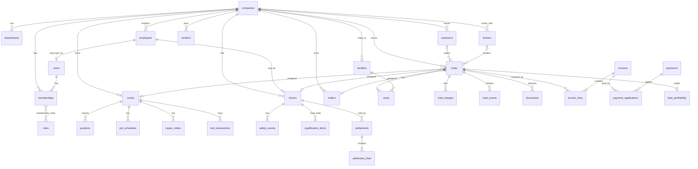

# NEWAY TMS — Database Design

PostgreSQL 16. Schema defined in Drizzle (`apps/api/src/database/schema/*.ts`, one file per module), migrations as SQL in `apps/api/src/database/migrations/`.

Related: [ARCHITECTURE.md](../ARCHITECTURE.md) · [MULTI_TENANCY.md](MULTI_TENANCY.md) · [RBAC.md](RBAC.md)

---

## 1. Conventions

| Topic | Rule |
|---|---|
| Primary keys | `id uuid` generated by the application as UUIDv7 (time-ordered; index-friendly; safe for imports) |
| Tenant column | `company_id uuid NOT NULL REFERENCES companies(id)` on **every** company-scoped table. Platform tables have no `company_id` |
| Human identifiers | `load_number`, `invoice_number`, `settlement_number`, `ro_number`, `employee_number`, `unit_number` are `text`, unique per company, generated from `sequences` |
| Timestamps | `created_at`, `updated_at` as `timestamptz` (UTC). Business-local times store three columns: `<x>_at timestamptz`, `<x>_local timestamp`, `<x>_tz text` (IANA name) |
| Actor columns | `created_by uuid NULL`, `updated_by uuid NULL` (user id); system/automation/AI actors are recorded in the audit log's `actor_type` |
| Soft delete | `deleted_at timestamptz NULL` on master data (users, employees, drivers, trucks, trailers, parties, documents). Transactional records are never deleted; they are cancelled, voided, or reversed |
| Optimistic concurrency | `version integer NOT NULL DEFAULT 1` on loads, stops, invoices, settlements, repair orders, payroll periods |
| Money | `numeric(14,2)` amounts; `numeric(10,4)` rates; `numeric(12,3)` gallons; `currency char(3) DEFAULT 'USD'` on money-bearing headers |
| Distance | miles `numeric(10,1)`; odometer `numeric(12,1)` |
| Enumerations | `text` + `CHECK (col IN (...))`. The allowed values live in `@neway/shared` enums so API, DB, and UI agree. Company-visible labels/colors/order live in `status_definitions` |
| User-managed reference data | Lookup tables with `is_system boolean` (document types, maintenance types, charge types, expense categories, departments) |
| JSON | `jsonb` only for raw provider payloads, workflow definitions, rule configs, settings, and free-form attributes. Never for fields that are filtered or summed |
| Naming | snake_case; plural tables; `<entity>_id` foreign keys; `ix_`, `uq_`, `ck_`, `fk_` prefixes |
| Row-level security | Enabled on every company-scoped table with a policy on `company_id = current_setting('app.company_id')::uuid` (see MULTI_TENANCY.md §4) |

---

## 2. Entity relationship overview

---

## 3. Entity catalog

Every company-scoped table also has: `id`, `company_id`, `created_at`, `updated_at`, `created_by`, `updated_by`. Only distinctive columns are listed.

### 3.1 Platform (no `company_id`)

| Table | Columns |
|---|---|
| `companies` | `slug` (unique), `name`, `legal_name`, `status` (trial/active/suspended/closed), `plan_id`, `timezone`, `country`, `settings jsonb`, `usdot`, `mc_number`, `scac`, `logo_document_id`, `created_at` |
| `plans` | `code`, `name`, `limits jsonb` (users, trucks, storage GB, AI tokens/month), `features jsonb`, `is_active` |
| `subscriptions` | `company_id`, `plan_id`, `status`, `starts_at`, `ends_at`, `notes` |
| `platform_users` | `email` (unique), `password_hash`, `mfa_secret_enc`, `platform_role` (super_admin/support/billing/read_only), `is_active` |
| `platform_settings` | `key`, `value jsonb` |
| `platform_audit_logs` | `at`, `actor_platform_user_id`, `action`, `target_company_id`, `detail jsonb` |
| `support_sessions` | `platform_user_id`, `company_id`, `reason`, `started_at`, `expires_at`, `ended_at` (audited entry into a tenant) |

### 3.2 IAM and company core

| Table | Columns |
|---|---|
| `users` | `email` (unique, global), `password_hash`, `first_name`, `last_name`, `phone_e164`, `mfa_secret_enc`, `mfa_enabled`, `locale`, `is_active`, `last_login_at`, `deleted_at`. **No `company_id`**: a user is a person; company access is via memberships |
| `memberships` | `company_id`, `user_id`, `employee_id NULL`, `status` (invited/active/suspended), `is_owner`, `invited_by`, `accepted_at`; `uq (company_id, user_id)` |
| `roles` | `company_id NULL` for system roles, `code`, `name`, `description`, `is_system` |
| `permissions` | `code` (`loads.view`), `module`, `action`, `description` — seeded from the code registry |
| `role_permissions` | `role_id`, `permission_id` |
| `membership_roles` | `membership_id`, `role_id`, `scope_kind` (company/department/team), `scope_id NULL` |
| `sessions` | `user_id`, `membership_id NULL` (active company), `refresh_hash`, `ip`, `user_agent`, `created_at`, `expires_at`, `revoked_at`, `last_seen_at` |
| `api_keys` | `company_id`, `name`, `key_hash`, `permission_codes text[]`, `expires_at`, `last_used_at`, `revoked_at` |
| `locations` | `name`, `kind` (office/terminal/yard/shop), address fields, `lat`, `lng`, `timezone` |
| `departments` | `code`, `name`, `manager_employee_id`, `is_system` |
| `settings` | `key`, `value jsonb`; `uq (company_id, key)` |
| `status_definitions` | `entity` (load/driver/truck/trailer/board), `code`, `label`, `color`, `sort_order`, `is_active`; `uq (company_id, entity, code)` |
| `sequences` | `kind`, `prefix`, `next_value`; `uq (company_id, kind)` |

### 3.3 Staff

| Table | Columns |
|---|---|
| `employees` | `employee_number`, names, `email`, `phone_e164`, `department_id`, `position`, `manager_employee_id`, `location_id`, `hire_date`, `termination_date`, `status` (active/on_leave/terminated), `employment_type` (full_time/part_time/contractor), `pay_type` (salary/hourly/commission), `pay_rate numeric(12,2)`, `timezone`, `deleted_at` |
| `position_history` | `employee_id`, `position`, `department_id`, `effective_from`, `effective_to` |
| `compensation_history` | `employee_id`, `pay_type`, `pay_rate`, `effective_from`, `reason` |
| `teams` | `kind` (dispatch/safety/maintenance/other), `name`, `lead_employee_id` |
| `team_members` | `team_id`, `employee_id`, `role_in_team`, `from_date`, `to_date` |
| `shifts` | `name`, `starts_local`, `ends_local`, `days_of_week int[]`, `timezone` |
| `shift_assignments` | `shift_id`, `employee_id`, `from_date`, `to_date` |
| `tasks` | `title`, `description`, `assignee_employee_id`, `department_id`, `entity_type`, `entity_id`, `priority`, `status` (open/in_progress/done/cancelled), `due_at`, `completed_at`, `source` (user/workflow/ai) |
| `activity_log` | `user_id`, `at`, `kind` (login/logout/page_view/action), `path`, `entity_type`, `entity_id`, `duration_ms` — presence and productivity; partitioned monthly |

### 3.4 Parties

| Table | Columns |
|---|---|
| `customers` | `name`, `mc_number`, `usdot`, billing address, `payment_terms_days`, `credit_limit`, `status`, `notes` |
| `brokers` | `name`, `mc_number`, `usdot`, billing address, `payment_terms_days`, `rating`, `do_not_use`, `do_not_use_reason`, `status` |
| `vendors` | `name`, `kind` (shop/fuel/tolls/parts/insurance/lease/other), address, `payment_terms_days`, `status` |
| `facilities` | `name`, address, `lat`, `lng`, `timezone`, `geofence_radius_m`, `hours jsonb`, `appointment_required`, `notes`, `avg_dwell_minutes` (computed) |
| `contacts` | `owner_type` (customer/broker/vendor/facility), `owner_id`, `name`, `role`, `email`, `phone_e164`, `is_primary` |

### 3.5 Fleet

| Table | Columns |
|---|---|
| `trucks` | `unit_number`, `vin`, `year`, `make`, `model`, `plate`, `plate_state`, `color`, `status` (available/assigned/driving/idle/in_shop/out_of_service/accident/maintenance/sold), `ownership` (owned/leased/owner_operator), `owning_entity`, `lease_id`, `odometer`, `odometer_at`, `engine_hours`, `in_service_date`, `out_of_service_date`, `current_driver_id`, `current_trailer_id`, `home_location_id`, `telematics_device_id`, `fuel_card_id`, `deleted_at`; `uq (company_id, unit_number)`, `uq (company_id, vin)` |
| `trailers` | `unit_number`, `vin`, `year`, `make`, `type` (dry_van/reefer/flatbed/step_deck/tanker/other), `length_ft`, `plate`, `status` (available/assigned/in_shop/out_of_service/sold), `ownership`, `current_truck_id`, `current_driver_id`, `deleted_at`; `uq (company_id, unit_number)` |
| `asset_assignments` | `kind` (driver_truck/truck_trailer/driver_trailer), `driver_id`, `truck_id`, `trailer_id`, `from_at`, `to_at`, `reason` — full history |
| `leases` | `lessor_vendor_id`, `asset_type`, `asset_id`, `start_date`, `end_date`, `start_odometer`, `annual_mile_limit`, `overage_rate`, `monthly_amount` |
| `telematics_devices` | `integration_account_id`, `external_id`, `serial`, `truck_id`, `installed_at`, `status` |
| `odometer_readings` | `truck_id`, `at`, `reading`, `source` (telematics/fuel/manual/inspection), `rejected_reason NULL` (regression guard) |

### 3.6 Drivers

| Table | Columns |
|---|---|
| `drivers` | `driver_number`, `employee_id NULL`, `user_id NULL` (portal login), names, `phone_e164`, `email`, `driver_type` (company/owner_operator/lease_operator), `cdl_number_enc`, `cdl_state`, `cdl_class`, `cdl_endorsements text[]`, `cdl_expires_on`, `medical_card_expires_on`, `hire_date`, `termination_date`, `status` (available/dispatched/driving/off_duty/sleeper/break/vacation/suspended/terminated), `dispatcher_employee_id`, `team_id`, `current_truck_id`, `current_trailer_id`, `home_address`, `emergency_contact jsonb`, `preferred_language`, `telegram_chat_id`, `safety_score numeric(5,2)`, `deleted_at`, `archived_at` / `archived_reason` / `archived_by` (0039: hidden from the Drivers page, pickers and boards; kept; restorable; status untouched) |
| `driver_pairs` | `lead_driver_id`, `co_driver_id`, `from_date`, `to_date` |
| `driver_pay_plans` | `driver_id`, `kind` (per_mile/percent_of_linehaul/flat_per_load/hourly), `rate numeric(10,4)`, `empty_mile_rate`, `effective_from`, `effective_to` |
| `driver_status_history` | `driver_id`, `status`, `from_at`, `to_at`, `source` (manual/telematics/system) |

### 3.7 Dispatch

| Table | Columns |
|---|---|
| `loads` | `load_number`, `status` (available/booked/assigned/dispatched/at_pickup/loading/loaded/in_transit/at_delivery/unloading/delivered/closed/cancelled/tonu), `exception` (NULL/problem/delayed), `exception_note`, `customer_id`, `broker_id`, `reference_numbers jsonb` (broker load #, PO, BOL #), `commodity`, `weight_lbs`, `pieces`, `equipment_type`, `temperature_f`, `hazmat`, `dispatcher_employee_id`, `driver_id`, `co_driver_id`, `truck_id`, `trailer_id`, `linehaul_rate`, `total_rate` (sum of billable charges), `loaded_miles`, `empty_miles`, `rpm` (computed), `first_pickup_at`, `last_delivery_at`, `booked_at`, `dispatched_at`, `delivered_at`, `closed_at`, `cancelled_at`, `cancel_reason`, `version`, `search tsvector`; `uq (company_id, load_number)` |
| `stops` | `load_id`, `sequence`, `kind` (pickup/delivery), `facility_id`, `appointment_start_at/_local/_tz`, `appointment_end_at`, `status` (pending/en_route/arrived/in_progress/completed/skipped), `arrived_at`, `started_at`, `completed_at`, `departed_at`, `detention_free_minutes`, `detention_minutes`, `notes`, `version` |
| `load_charges` | `load_id`, `charge_type_id`, `description`, `amount`, `billable` (to customer), `payable_to_driver`, `proof_document_id`, `stop_id NULL` |
| `load_expenses` | `load_id`, `expense_category_id`, `amount`, `source` (manual/fuel_allocation/toll/maintenance_allocation/driver_pay), `source_id`, `vendor_id` |
| `load_assignments` | `load_id`, `dispatcher_employee_id`, `driver_id`, `co_driver_id`, `truck_id`, `trailer_id`, `assigned_at`, `unassigned_at`, `reason` |
| `load_status_history` | `load_id`, `from_status`, `to_status`, `at`, `actor_user_id`, `source` (user/tracking/workflow/ai), `note` |
| `load_events` | `load_id`, `at`, `kind` (booked/assigned/dispatched/arrived/loading_started/loaded/departed/eta_changed/document_uploaded/note_added/status_changed/exception_raised/…), `actor_type`, `actor_id`, `payload jsonb` — the timeline |
| `load_notes` | `load_id`, `kind` (internal/broker/driver), `body`, `author_user_id`, `pinned` |
| `trips` | `driver_id`, `truck_id`, `started_at`, `ended_at`, `status` — groups consecutive loads for settlement |
| `trip_loads` | `trip_id`, `load_id`, `sequence` |
| `dispatch_board_cells` | `driver_id`, `date`, `board_status` (from status_definitions entity=board), `note`, `typed_by_user_id`, `load_id NULL` |
| `dispatch_board_snapshots` | `date`, `team_id`, `payload jsonb` (immutable daily snapshot for KPI history) |
| `detention_entries` | `load_id`, `stop_id`, `minutes`, `rate_per_hour`, `billed_amount`, `recovered_amount`, `status` (pending/billed/recovered/denied), `logged_by_employee_id` |

Load status transitions are enforced in the dispatch service (a transition table in `@neway/shared`); `exception` overlays any active status (a load can be `in_transit` and `delayed`). `cancelled` and `tonu` are terminal.

### 3.8 Tracking

| Table | Columns |
|---|---|
| `positions` | **partitioned by month on `at`**. `truck_id`, `driver_id NULL`, `at`, `lat`, `lng`, `speed_mph`, `heading`, `odometer`, `engine_state`, `integration_account_id`; `pk (truck_id, at)` |
| `truck_live_state` | `truck_id` PK, `lat`, `lng`, `speed_mph`, `heading`, `engine_state`, `last_position_at`, `hos_status`, `hos_drive_remaining_min`, `hos_shift_remaining_min`, `current_load_id`, `next_stop_id`, `eta_at`, `miles_remaining`, `eta_computed_at`, `geo_state` (off_route/en_route/at_stop) |
| `geofences` | `facility_id NULL`, `name`, `shape` (circle/polygon), `center_lat`, `center_lng`, `radius_m`, `polygon jsonb` |
| `tracking_events` | **partitioned by month**. `truck_id`, `load_id NULL`, `stop_id NULL`, `at`, `kind` (geofence_enter/geofence_exit/idle_start/idle_end/speeding/long_stop/gps_offline/gps_online/route_deviation/eta_changed), `payload jsonb` |
| `tracking_alerts` | `truck_id`, `load_id NULL`, `kind` (late_eta/route_deviation/excessive_idle/excessive_speed/long_stop/unexpected_stop/missed_appointment/gps_offline/vehicle_offline), `severity`, `opened_at`, `closed_at`, `dedupe_key` unique |
| `route_cache` | `origin_hash`, `destination_hash`, `provider`, `distance_miles`, `duration_min`, `polyline`, `computed_at` |

### 3.9 Maintenance

| Table | Columns |
|---|---|
| `maintenance_types` | `code` (oil_change/pm_service/brake_inspection/tire_rotation/tire_replacement/dot_inspection/coolant/transmission/engine/dpf/battery/electrical/other), `name`, `default_interval_miles`, `default_interval_days`, `is_system` |
| `pm_schedules` | `asset_type` (truck/trailer), `asset_id`, `maintenance_type_id`, `interval_miles`, `interval_days`, `last_done_at`, `last_done_odometer`, `next_due_at`, `next_due_odometer`, `status` (ok/due_soon/overdue/scheduled/in_shop), `scheduled_for`, `vendor_id NULL` |
| `repair_orders` | `ro_number`, `asset_type`, `asset_id`, `status` (draft/open/approved/in_shop/completed/cancelled), `priority`, `vendor_id`, `technician`, `opened_at`, `promised_at`, `in_shop_at`, `completed_at`, `odometer`, `downtime_minutes`, `parts_total`, `labor_total`, `fees_total`, `total`, `warranty`, `invoice_document_id`, `notes`, `version`; `uq (company_id, ro_number)` |
| `repair_order_lines` | `repair_order_id`, `kind` (labor/part/fee), `maintenance_type_id NULL`, `part_id NULL`, `description`, `quantity`, `unit_cost`, `total` |
| `service_records` | `asset_type`, `asset_id`, `maintenance_type_id`, `done_at`, `odometer`, `vendor_id`, `cost`, `repair_order_id NULL`, `document_id NULL`, `notes` — immutable history |
| `parts` | `part_number`, `description`, `category`, `unit_cost`, `preferred_vendor_id` |
| `part_stock` | `part_id`, `location_id`, `quantity_on_hand`, `reorder_point` |
| `part_movements` | `part_id`, `location_id`, `quantity_delta`, `reason` (purchase/repair_order/adjustment), `repair_order_id NULL`, `at` |
| `tires` | `serial`, `dot_code`, `brand`, `model`, `asset_type`, `asset_id`, `position`, `installed_at`, `installed_odometer`, `removed_at`, `status` |
| `tire_readings` | `tire_id`, `at`, `tread_depth_32nds`, `pressure_psi` |
| `inspections` | `asset_type`, `asset_id`, `kind` (annual_dot/pre_trip/post_trip/roadside/other), `at`, `inspector`, `result` (pass/fail), `defects jsonb`, `document_id`, `driver_id NULL` |
| `defects` | `asset_type`, `asset_id`, `source` (inspection/telematics/driver_report/mpg_drop), `severity`, `description`, `status` (open/scheduled/resolved/deferred), `repair_order_id NULL`, `reported_at`, `resolved_at` |

### 3.10 Safety & compliance

| Table | Columns |
|---|---|
| `safety_events` | `driver_id`, `truck_id`, `at`, `kind` (speeding/hard_brake/hard_acceleration/following_distance/seatbelt/distraction/hos_violation/other), `severity`, `lat`, `lng`, `speed_mph`, `speed_limit_mph`, `integration_account_id`, `external_id`, `video_url`, `coached_at`, `coached_by`, `dismissed`; `uq (company_id, integration_account_id, external_id)` |
| `violations` | `driver_id`, `truck_id`, `on_date`, `category` (unsafe_driving/hos/driver_fitness/controlled_substances/vehicle_maintenance/hazmat/crash), `code`, `description`, `points`, `source` (roadside/company), `inspection_id NULL`, `document_id`, `contested`, `resolved_at` |
| `accidents` | `at`, `driver_id`, `truck_id`, `trailer_id`, `load_id NULL`, `location`, `description`, `preventable` (yes/no/undetermined), `dot_recordable`, `injuries`, `fatalities`, `towed`, `police_report_document_id`, `status` |
| `claims` | `accident_id NULL`, `kind` (cargo/liability/physical_damage/workers_comp), `insurer`, `claim_number`, `status`, `reserve_amount`, `paid_amount`, `opened_at`, `closed_at` |
| `drug_alcohol_tests` | `driver_id`, `kind` (pre_employment/random/post_accident/reasonable_suspicion/return_to_duty/follow_up), `ordered_at`, `collected_at`, `result` (pending/negative/positive/refusal), `vendor_id`, `document_id` |
| `training_courses`, `training_records` | course catalog; `driver_id/employee_id`, `completed_at`, `expires_at`, `score`, `document_id` |
| `safety_meetings`, `safety_meeting_attendance` | `at`, `topic`; attendee rows |
| `safety_scores` | `scope` (company/driver/truck), `scope_id`, `period_start`, `period_end`, `score`, `components jsonb` — snapshots |
| `qualification_requirements` | `scope` (driver/truck/trailer/company), `code` (cdl/medical_card/mvr/clearinghouse/drug_test/registration/annual_inspection/insurance/…), `name`, `description`, `authority`, `document_type_id`, `has_expiry`, `requires_document`, `requires_verification`, `requires_consent`, `lead_days int[]`, `grace_period_days`, `escalation jsonb` (rungs of `{at_days_remaining, notify[], severity}`), `hold_effect` (none/advisory/driver_hold/unit_hold/company_hold), `owner_role`, `applies_when jsonb`, `active`, `is_system` — contract and engine in `packages/shared/src/compliance` (docs/SAFETY.md) |
| `qualification_items` | `requirement_id`, `scope`, `entity_id`, `document_id NULL`, `issued_on`, `expires_on`, `verified_at`, `verified_by`, `verification_failed`, `verification_note`, `waived_until`, `waived_reason`, `not_applicable`, `notes`. **Status is not stored**: it is derived by the shared engine from these columns and the clock (missing/pending_verification/verification_failed/verified/valid/expiring/expired/waived/not_applicable), so it can never go stale |
| `consent_requests` | `driver_id`, `purpose` (mvr/psp/background_check/employment_verification/clearinghouse/drug_alcohol_testing/safety_investigation), `requirement_code`, `status` (draft/sent/viewed/signed/declined/expired/cancelled), `requested_at/by`, `sent_at`, `viewed_at`, `signed_at`, `declined_at`, `expires_at`, `signer_name`, `signer_channel`, `signed_document_id`, `public_link_id`; transitions in `consent_events` |
| `verification_cases`, `verification_steps` | `driver_id`, `stage` (recruiting/document_collection/consent/screening/verification/safety_review/decision/active), `owner_id`, `decision` (approved/conditional/rejected), `decision_at/by`, `conditions text[]`, `decision_note`; steps: `key`, `stage`, `status` (not_started/in_progress/blocked/complete), `requirement_code`, `blocker`, `completed_at/by` |
| `holds` | `scope`, `entity_id`, `reason`, `placed_by_kind` (system/user), `placed_by_user_id`, `placed_at`, `released_at`, `released_by`, `release_note` |
| dispatch gates | materialized on `drivers.dispatchable`, `trucks.dispatchable`, `trailers.dispatchable`, `companies.authority_current` with `gate_reasons text[]`, refreshed by the compliance job and on item change |

### 3.11 Documents

| Table | Columns |
|---|---|
| `document_types` | `code`, `name`, `owner_types text[]`, `has_expiry`, `lead_days int[]`, `retention_years`, `is_pii`, `is_system` |
| `documents` | `owner_type` (company/employee/driver/truck/trailer/load/customer/broker/vendor/repair_order/invoice/claim/accident), `owner_id`, `document_type_id`, `title`, `storage_key`, `sha256`, `content_type`, `size_bytes`, `issued_on`, `expires_on`, `version`, `supersedes_document_id`, `status` (pending_review/verified/rejected/expired), `uploaded_via` (staff/driver_portal/public_link/integration/email), `uploaded_by`, `verified_by`, `verified_at`, `tags text[]`, `deleted_at` |
| `document_access_log` | `document_id`, `user_id`, `action` (view/download/share), `at`, `ip` — partitioned monthly |
| `public_links` | `purpose` (upload/track/sign), `entity_type`, `entity_id`, `token_hash`, `expires_at`, `max_uses`, `uses`, `created_by`, `revoked_at` |

### 3.12 Fuel

| Table | Columns |
|---|---|
| `fuel_cards` | `integration_account_id NULL`, `provider`, `external_id`, `last4`, `truck_id`, `driver_id`, `status`, `limits jsonb` |
| `fuel_stations` | `name`, `brand`, `address`, `lat`, `lng`, `state`, `external_ref` |
| `fuel_transactions` | `fuel_card_id`, `truck_id`, `driver_id`, `load_id NULL`, `station_id`, `at`, `product` (diesel/def/reefer/other), `gallons`, `price_per_gallon`, `amount`, `odometer_reported`, `odometer_telematics`, `state`, `source` (integration/import/manual), `integration_account_id`, `external_id`, `anomaly_flags text[]`, `receipt_document_id`; `uq (company_id, source, external_id)` |
| `fuel_anomalies` | `fuel_transaction_id`, `kind` (location_mismatch/impossible_gallons/duplicate/excess_consumption/mpg_drop/card_misuse/off_hours), `severity`, `detail jsonb`, `status` (open/confirmed/dismissed), `dedupe_key` unique |
| `fuel_stats_daily` | `truck_id`, `driver_id NULL`, `date`, `miles`, `gallons`, `mpg`, `cost`, `cost_per_mile`, `idle_gallons` — read model |
| `ifta_periods`, `ifta_state_miles` | `quarter`, `status`; `truck_id`, `state`, `miles`, `gallons` |

### 3.13 Accounting

| Table | Columns |
|---|---|
| `charge_types` | `code` (linehaul/fuel_surcharge/detention/layover/tonu/lumper/stop_charge/other), `name`, `default_billable`, `default_payable_to_driver`, `is_system` |
| `expense_categories` | `code` (fuel/tolls/maintenance/driver_pay/insurance/lease/permits/other), `name`, `cost_class` (variable/fixed), `is_system` |
| `invoices` | `invoice_number`, `bill_to_type` (customer/broker), `bill_to_id`, `issued_on`, `due_on`, `subtotal`, `total`, `balance`, `status` (draft/issued/sent/factored/partially_paid/paid/disputed/short_paid/void), `revision`, `credit_memo_of_invoice_id`, `factoring_batch_id`, `bill_to_snapshot jsonb`, `version`; `uq (company_id, invoice_number)` |
| `invoice_lines` | `invoice_id`, `load_id`, `load_charge_id NULL`, `description`, `amount` |
| `factoring_batches` | `batch_number`, `factor_vendor_id`, `status` (open/submitted/funded/closed), `submitted_at`, `funded_at`, `advance_rate`, `fee_amount` |
| `payments` | `direction` (in/out), `party_type`, `party_id`, `amount`, `method` (ach/check/card/wire/factoring/cash), `received_on`, `reference`, `document_id`, `unapplied_amount` |
| `payment_applications` | `payment_id`, `invoice_id NULL`, `bill_id NULL`, `amount`, `applied_at` |
| `bills` (AP) | `vendor_id`, `bill_number`, `issued_on`, `due_on`, `amount`, `balance`, `status` (open/scheduled/paid/void/disputed), `expense_category_id`, `source` (repair_order/fuel/tolls/lease/manual), `source_id`, `document_id` |
| `expenses` | `expense_category_id`, `amount`, `on_date`, `truck_id NULL`, `driver_id NULL`, `load_id NULL`, `vendor_id NULL`, `source` (manual/fuel/maintenance/tolls/payroll/settlement/allocation), `source_id`, `document_id`, `ledger_period_id` |
| `fixed_costs` | `truck_id`, `expense_category_id`, `monthly_amount`, `effective_from`, `effective_to` — allocated to loads by miles |
| `ledger_periods` | `year`, `month`, `status` (open/closed), `closed_at`, `closed_by`; postings into a closed period are rejected |
| `load_profitability` | `load_id` PK, `revenue`, `fuel_cost`, `driver_pay`, `tolls`, `maintenance_allocation`, `fixed_allocation`, `other_cost`, `gross_profit`, `total_miles`, `rpm`, `cost_per_mile`, `profit_per_mile`, `computed_at` — read model |

### 3.14 Settlements & payroll

| Table | Columns |
|---|---|
| `settlements` | `settlement_number`, `driver_id`, `period_start`, `period_end`, `status` (draft/finalized/paid/reversed), `gross`, `deductions`, `net`, `finalized_at`, `finalized_by`, `paid_at`, `statement_document_id`, `version` |
| `settlement_lines` | `settlement_id`, `kind` (load_pay/accessorial/reimbursement/bonus/deduction/escrow/advance/adjustment), `load_id NULL`, `description`, `amount` |
| `deduction_plans` | `driver_id`, `kind` (escrow/insurance/lease/advance_repayment/other), `amount_per_period`, `total_cap`, `balance`, `starts_on`, `ends_on`, `status` |
| `escrow_accounts`, `escrow_transactions` | `driver_id`, `balance`; `amount`, `kind`, `settlement_id` |
| `payroll_periods` | `kind` (staff), `period_start`, `period_end`, `status` (draft/finalized/paid/reversed), `finalized_at`, `paid_at` |
| `payslips` | `payroll_period_id`, `employee_id`, `base_pay`, `bonuses`, `deductions`, `net_pay`, `breakdown jsonb`, `locked` |
| `compensation_adjustments` | `employee_id`, `kind` (bonus/deduction), `amount`, `reason`, `entity_type`, `entity_id`, `payroll_period_id NULL`, `locked` |
| `pay_rules` | `code`, `name`, `applies_to` (dispatcher/updater/…), `config jsonb`, `effective_from`, `effective_to` — company-defined commission/bonus rules, versioned so paid periods never change |

### 3.15 HR

| Table | Columns |
|---|---|
| `applicants` | names, contact, `position`, `source`, `stage` (applied/screening/interview/assessment/offer/hired/rejected/withdrawn — the office vocabulary; **driver candidates are not moved through it**, their state is the hiring case's), `assigned_recruiter_employee_id`, `driver_type`, `notes`, `hired_employee_id` |
| `offers` | `applicant_id`, `offer_number`, position/department/employment type, `status`; driver offers add `hiring_case_id`, `driver_type`, `pay_plan_kind`/`pay_plan_rate`, `sign_on_bonus`, `referral_bonus`, `referring_driver_id`, `orientation_date`, `sent_at` |
| `onboarding_templates`, `onboarding_template_items` | template per position and, for drivers, per `driver_type`; items carry `blocking`, `owner_role`, `requirement_code` |
| `onboarding_checklists`, `onboarding_items` | checklist per hire; items carry the same three flags — a `requirement_code` item completes from the qualification file, never by hand |
| **Hiring (see `docs/HIRING.md`)** | |
| `hiring_leads` | `lead_number`, names, `phone`, `source`, `campaign_id`, `status` (new/contacted/prequalified/converted/dead), `prequalification jsonb` (answers), `prequal_result jsonb` (verdict with failed rules named), `applicant_id`, `hiring_case_id`, `dead_reason` |
| `hiring_cases` | `applicant_id`, `driver_id` (the qualification-file key, reserved at application), `verification_case_id`, `state` (lead/prequalified/application/checks/safety_review/offer/ticketed/orientation/hired/active_driver + terminal), `offer_id`, `employee_id`, `hired_at`, `first_dispatch_at` |
| `hiring_stage_events` | append-only: `case_id`, `from_state`, `to_state`, `at`, `by`, `reason`, `source` (user/system/verification) |
| `hiring_dot_applications` | `hiring_case_id`, `form jsonb` (391.21 answers), `ssn_sealed`, `ssn_last4`, `document_id`, `consent_ids`, `status` (draft/submitted) |
| `hiring_tickets`, `hiring_orientations` | travel to orientation (mode, carrier, times, costs); orientation attendance, days, per-day pay, `road_test jsonb`, `road_test_document_id` |
| `hiring_campaigns` | `name`, `channel`, `period_start`/`period_end`, `spend`, `owner_employee_id`, `active` |
| `hiring_cost_entries` | one amount against a case or a lead: `type`, `amount`, `incurred_on`, `source` (manual/auto), `source_ref` (unique; the record an auto entry was priced from) |
| `pto_policies` | `name`, `accrual_hours_per_period`, `period`, `max_balance_hours`, `carryover_hours` |
| `pto_balances` | `employee_id`, `policy_id`, `balance_hours`, `as_of` |
| `pto_requests` | `employee_id`, `starts_on`, `ends_on`, `hours`, `status` (pending/approved/denied/cancelled), `approver_employee_id`, `decided_at` |
| `attendance_entries` | `employee_id`, `date`, `check_in_at`, `check_out_at`, `source` (manual/device/system), `device_id`, `notes` |
| `performance_reviews` | `employee_id`, `reviewer_employee_id`, `period_start`, `period_end`, `score`, `summary`, `status` |
| `performance_events` | `employee_id`, `at`, `kind` (commendation/warning/incident/goal), `points`, `note`, `entity_type`, `entity_id` |

### 3.16 Notifications, workflows, audit, AI, integrations, search

| Table | Columns |
|---|---|
| `domain_events` | **partitioned monthly**. `at`, `type`, `aggregate_type`, `aggregate_id`, `actor_type`, `actor_id`, `payload jsonb`, `request_id` |
| `event_deliveries` | `event_id`, `handler`, `status` (pending/done/failed), `attempts`, `last_error`, `done_at`; `uq (event_id, handler)` |
| `notifications` | `recipient_user_id`, `severity` (critical/warning/info/success), `title`, `body`, `entity_type`, `entity_id`, `source` (system/workflow/ai/user), `dedupe_key`, `read_at`, `archived_at` |
| `notification_subscriptions` | `target_kind` (user/role/department), `target_id`, `event_pattern`, `channels text[]`, `min_severity` |
| `notification_preferences` | `user_id`, `channel`, `enabled`, `digest` (immediate/hourly/daily), `quiet_from`, `quiet_to` |
| `notification_deliveries` | **partitioned monthly**. `notification_id`, `channel`, `status` (queued/sent/failed/skipped), `attempts`, `provider_ref`, `error`, `sent_at` |
| `workflow_rules` | `name`, `description`, `trigger_kind` (event/schedule), `trigger` (event type or cron), `conditions jsonb`, `actions jsonb`, `is_active`, `version`, `owner_user_id` |
| `workflow_runs` | `rule_id`, `event_id NULL`, `started_at`, `finished_at`, `status`, `error` |
| `workflow_run_steps` | `run_id`, `step_index`, `action`, `status`, `result jsonb`, `approval_id NULL` |
| `approvals` | `kind` (workflow_action/ai_action), `subject_id`, `required_permission`, `status` (pending/approved/rejected/expired), `requested_at`, `decided_at`, `decided_by`, `note` |
| `audit_logs` | **partitioned monthly**. `at`, `actor_type` (user/platform_user/system/workflow/ai/integration/api_key), `actor_id`, `actor_name`, `action` (create/update/delete/status_change/assign/approve/login/…), `entity_type`, `entity_id`, `entity_label`, `changes jsonb` (`[{field, old, new}]`), `summary text`, `request_id`, `ip`, `user_agent` |
| `ai_insights` | `kind`, `severity`, `scope` (load/truck/driver/company/…), `scope_id`, `title`, `detail`, `evidence jsonb`, `detector`, `confidence`, `opened_at`, `resolved_at`, `dedupe_key` unique |
| `ai_recommendations` | `insight_id`, `action_type`, `params jsonb`, `rationale`, `status` (open/accepted/dismissed/expired), `decided_by`, `decided_at`, `dismiss_reason` |
| `ai_actions` | `recommendation_id NULL`, `action_type`, `params jsonb`, `permission_level` (suggest/require_approval/auto_execute), `status` (proposed/awaiting_approval/approved/rejected/executed/failed), `approval_id NULL`, `executed_at`, `result jsonb`, `audit_log_id` |
| `ai_action_policies` | `action_type`, `permission_level`, `approver_role_id NULL`; `uq (company_id, action_type)` |
| `ai_conversations`, `ai_messages` | `user_id`, `title`; `role`, `content jsonb`, `tool_calls jsonb`, `tokens_in`, `tokens_out` |
| `ai_usage_daily` | `date`, `model`, `tokens_in`, `tokens_out`, `cost_estimate` |
| `integration_accounts` | `provider`, `category` (telematics/fuel_card/load_board/maps/messaging/accounting/payments/weather/storage/llm), `label`, `credentials_enc`, `config jsonb`, `status` (disconnected/connected/error/mock), `last_sync_at`, `last_error` |
| `sync_runs` | `integration_account_id`, `kind`, `started_at`, `finished_at`, `status`, `cursor_before`, `cursor_after`, `counts jsonb`, `error` |
| `webhook_events` | `provider`, `integration_account_id NULL`, `received_at`, `signature_valid`, `headers jsonb`, `payload jsonb`, `processed_at`, `error` |
| `external_refs` | `entity_type`, `entity_id`, `provider`, `external_id`; `uq (company_id, provider, entity_type, external_id)` |
| `job_runs` | `job`, `started_at`, `finished_at`, `status`, `error`, `company_id NULL` |
| `search_index` | `entity_type`, `entity_id`, `label`, `secondary`, `search tsvector`, `updated_at` — one row per searchable entity, maintained by event handlers |

---

## 4. Key state machines

**Load** — `available → booked → assigned → dispatched → at_pickup → loading → loaded → in_transit → at_delivery → unloading → delivered → closed`. From any non-terminal state: `cancelled` or `tonu` (terminal). `exception ∈ {problem, delayed}` is an overlay, not a state. `closed` requires: `delivered` + POD document verified + rate confirmation present + all charges typed. Multi-stop loads cycle `at_pickup/loading/loaded` and `at_delivery/unloading` per stop; the load status reflects the current stop.

**Truck** — `available ↔ assigned ↔ driving ↔ idle`; any → `in_shop` / `maintenance` / `out_of_service` / `accident`; `sold` terminal. `dispatchable` is a computed gate, not a status.

**Driver** — `available ↔ dispatched ↔ driving ↔ off_duty/sleeper/break`; `vacation`, `suspended` (blocks assignment); `terminated` terminal.

**Invoice** — `draft → issued → sent → (factored) → partially_paid → paid`; `disputed`, `short_paid` overlay; `void` terminal. Corrections are credit memos plus a new revision, never edits of an issued invoice.

**Settlement / payroll period** — `draft → finalized → paid`; `reversed` from finalized/paid creates a compensating record; finalized lines are locked.

---

## 5. Multi-tenant enforcement in the schema

See [MULTI_TENANCY.md](MULTI_TENANCY.md). In short: `company_id NOT NULL` + FK, composite uniques include `company_id`, RLS policy on every company table, and the application role connects with a non-bypass role.

---

## 6. Indexing and partitioning

- Every FK indexed. List-screen tables get `(company_id, status)`, `(company_id, updated_at desc)`, and the natural-key unique.
- `loads`: `(company_id, status)`, `(company_id, dispatcher_employee_id, status)`, `(company_id, driver_id, delivered_at)`, `(company_id, first_pickup_at)`, GIN on `search`.
- `stops`: `(load_id, sequence)`, `(company_id, appointment_start_at) WHERE status IN ('pending','en_route')`.
- `positions`: primary key `(truck_id, at)` per monthly partition; BRIN on `at`.
- `fuel_transactions`: `(company_id, truck_id, at)`, `(company_id, at)`.
- `documents`: `(company_id, owner_type, owner_id)`, `(company_id, expires_on) WHERE expires_on IS NOT NULL AND deleted_at IS NULL`.
- `audit_logs`, `domain_events`, `tracking_events`, `activity_log`, `notification_deliveries`, `document_access_log`: monthly partitions by time; `(company_id, entity_type, entity_id, at)`.
- `search_index`: GIN on `search`, `(company_id, entity_type)`.
- Every `dedupe_key` unique.

Partition maintenance (create next month, drop expired) is a scheduled job.

---

## 7. Migrations

- Drizzle-kit generates SQL migrations; every migration is reviewed as SQL and is reversible or explicitly documented as irreversible.
- Migrations run as a deploy step, never on application boot.
- RLS policies and partitions are created in migrations alongside tables, not by hand.
- A `schema_lint` test asserts: every company table has `company_id NOT NULL`, an RLS policy, and `created_at/updated_at`; every enum column has a CHECK; no `float` money.

---

## 8. Seed and demo data

- `apps/api/src/database/seed/` builds one demo company ("Northwind Freight") with realistic data: units 2785, 3012, 3091, 3120…; Freightliner Cascadia, Volvo VNL, Kenworth T680, Peterbilt 579, Mack Anthem; drivers, brokers, customers, facilities, 90 days of loads, fuel transactions, maintenance records, safety events, invoices, settlements.
- Demo data is flagged (`companies.settings.demo = true`) and generated only by an explicit command. It is never created in production and the platform admin UI shows the demo flag.
- Seeds are deterministic (fixed random seed, pinned "today") so tests can assert exact numbers.

---

## 9. Retention

| Data | Retention |
|---|---|
| Raw positions | 13 months, then downsampled to 1 point / 15 min kept 3 years |
| Tracking events, activity log | 24 months |
| Domain events | 6 months (event_deliveries pruned with them) |
| Audit logs, financial records, settlements, documents with financial relevance | 7 years |
| Notification deliveries | 6 months |
